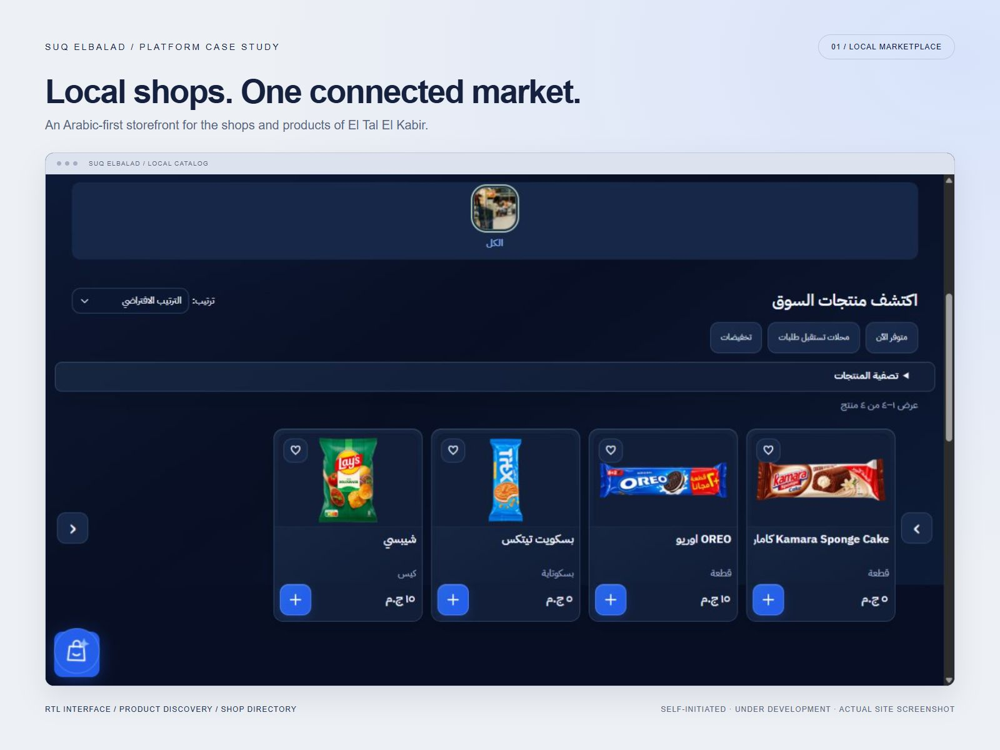
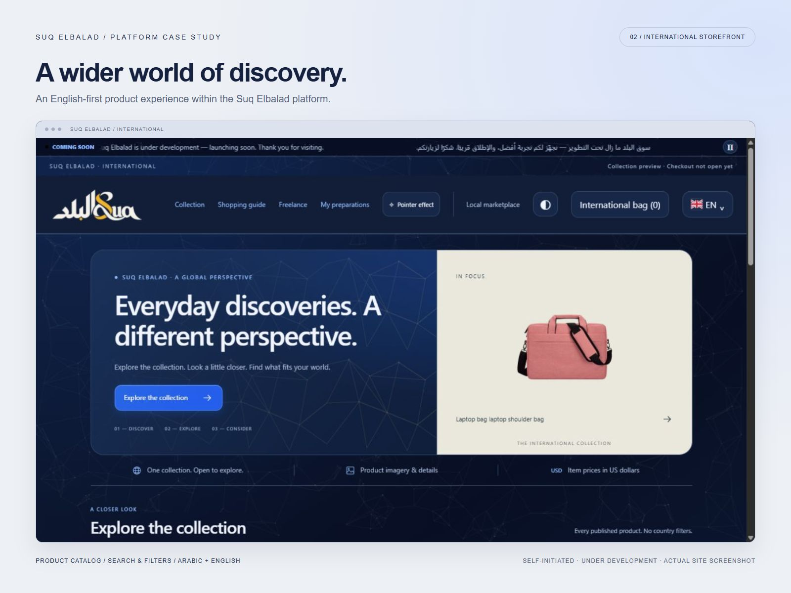
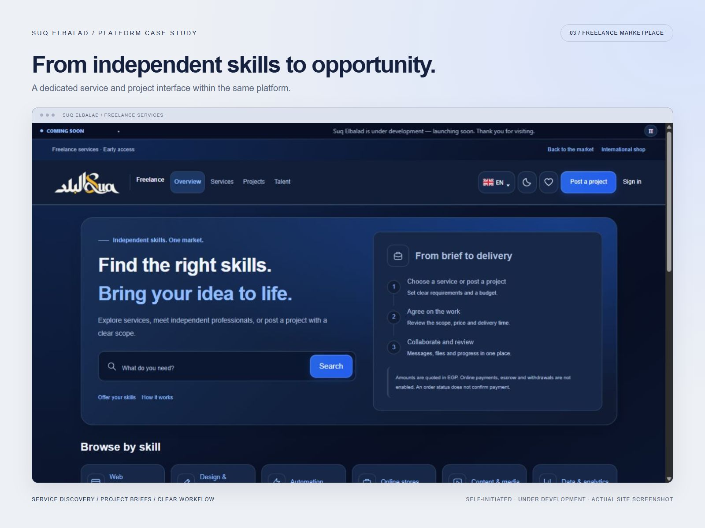

# Suq Elbalad

### One platform. Three marketplace experiences.

Suq Elbalad brings local shopping, international product discovery, and freelance service discovery into a shared marketplace experience.

[Explore the platform](https://suq-elbalad.com/) · [View my Upwork portfolio](https://www.upwork.com/freelancers/~0177276d8a742e7b0c)

## Local marketplace

An Arabic-first shopping experience for El Tal El Kabir, Egypt. The interface supports product discovery, search, sorting, availability filters, favorites, a shopping bag, and shop discovery.

## International storefront

An English-first storefront with Arabic support, product discovery, sorting, maximum-price filtering, and product detail views.

[View the international storefront](https://suq-elbalad.com/international.html)

## Freelance services

An early-access service marketplace for discovering skills, exploring categories, and starting project briefs, with a clear overview of the request and delivery workflow.

[View freelance services](https://suq-elbalad.com/freelance)

## My role

Project owner and interface development. These three experiences belong to the same self-initiated platform.

## Project status and scope

The platform is under development. This repository presents the public interfaces through actual site screenshots. International checkout is not enabled. Freelance online payments, escrow, and withdrawals are not enabled.

This is a project showcase. Production application source, credentials, and customer data are not included.
